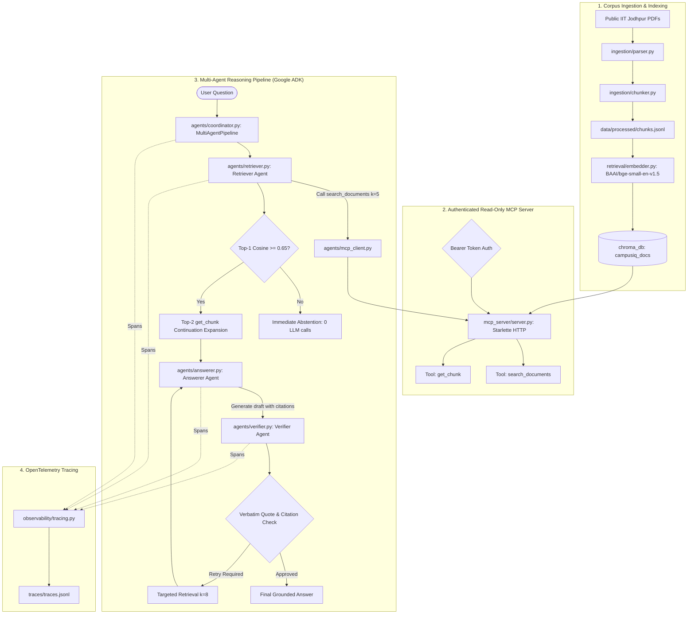

# CampusIQ: Grounded Academic QA for IIT Jodhpur

CampusIQ is an institutional question-answering system designed to answer questions strictly grounded in public academic regulations, curricula, statutes, and calendars from the Indian Institute of Technology Jodhpur (IIT Jodhpur), providing exact document and page citations (`[Title, p.X]`) or explicitly abstaining (`"I could not find this in the documents."`) when source text is insufficient. The corpus consists of 13 publicly available PDF documents cataloged in [`data/sources.csv`](file:///data/sources.csv), partitioned into 321 dense passage chunks indexed in a local ChromaDB vector store. The architecture is implemented in Python using `BAAI/bge-small-en-v1.5` embeddings, ChromaDB, Google Gemini API (`gemini-3.5-flash-lite`), Google Agent Development Kit (Google ADK `google-adk`), a Model Context Protocol (MCP) streamable HTTP server (`mcp`), FastAPI/Starlette, and OpenTelemetry (`opentelemetry-sdk`).

> [!CAUTION]
> **Disclaimer:** CampusIQ is an independent student academic project. It is not an official IIT Jodhpur service or tool, is not endorsed by IIT Jodhpur administration, and may make mistakes or misinterpret regulatory clauses. Official administrative decisions must always refer directly to the authorized institute authorities.

---

## 1. Results at a Glance

Benchmark comparison on the frozen institutional evaluation dataset ($n=34$ questions: $23$ answerable, $11$ unanswerable). All systems evaluated against the identical target LLM: `gemini-3.5-flash-lite`.

| Evaluation Category & Metric | RAG Baseline (`eval/results/rag_baseline_scored.json`) | Multi-Agent v2 (`eval/results/multi_agent_v2_scored.json`) | Multi-Agent v1 Reference (`eval/results/multi_agent_v1_scored.json`) |
| :--- | :---: | :---: | :---: |
| **Unanswerable Questions ($n=11$)** | | | |
| • Correct Abstentions | **11 / 11** (100.0%) | **11 / 11** (100.0%) | **11 / 11** (100.0%) |
| • Wrong Answers (Hallucinations) | **0 / 11** (0.0%) | **0 / 11** (0.0%) | **0 / 11** (0.0%) |
| **Answerable Questions ($n=23$)** | | | |
| • Answered (Did not abstain) | 15 / 23 (65.2%) | **19 / 23** (82.6%) | 7 / 23 (30.4%) |
| • Correct Verdicts | 10 / 23 (43.5%) | **12 / 23** (52.2%) | 4 / 23 (17.4%) |
| • Partial Verdicts | 3 / 23 (13.0%) | 4 / 23 (17.4%) | 0 / 23 (0.0%) |
| • Incorrect Verdicts | 10 / 23 (43.5%) | **7 / 23** (30.4%) | 19 / 23 (82.6%) |
| • Wrong Abstentions | 8 / 23 (34.8%) | **4 / 23** (17.4%) | 16 / 23 (69.6%) |
| **Citations (Answered Questions)** | | | |
| • Citation Accuracy ($\ge 1$ cited page in GT) | **13 / 15** (86.7%) | 16 / 19 (84.2%) | 0 / 7 (0.0%) |
| • Total Cited Markers | 22 | **32** | 2 |
| • Invalid Citations (Unmatched chunks) | 1 / 22 (4.5%) | **0 / 32** (0.0%) | **0 / 2** (0.0%) |
| **Live Latency ($n=8$ Uncached Run)** | | | |
| • All Queries Median Latency | 520.4 ms | 2,872.3 ms | — |
| • All Queries Max Latency | 1,184.9 ms | 23,441.1 ms | — |
| • Answered Queries ($n=4$) Median Latency | 1,064.3 ms | 7,003.5 ms | — |
| • Answered Queries ($n=4$) Max Latency | 1,182.8 ms | 23,441.1 ms | — |
| **Efficiency Metrics ($n=34$)** | | | |
| • Mean LLM Calls / Question | **0.88** (30 / 34) | 1.59 (54 / 34) | 1.50 (51 / 34) |
| • Mean MCP Tool Calls / Question | **0.00** (Direct) | 3.12 | 1.41 |
| • Mean Total Tokens / Question | 2,925.9 | 6,121.1 | 1,321.7 |

> [!IMPORTANT]
> **Headline Honesty Disclosures:**
> 1. **Post-Hoc Tuning:** Multi-Agent v2 was tuned after inspecting error logs and failure modes on this same 34-question evaluation dataset. The reported gains reflect test-set tuning and require confirmation on a fresh, held-out evaluation suite.
> 2. **Sample Size:** The evaluation dataset is small ($n=23$ answerable, $n=11$ unanswerable; 34 total). While targeted at specific institutional rules, small subgroup counts limit broad statistical generalization.

---

## 2. Architecture



### Component Breakdown
- **Corpus Ingestion & Parser** ([`ingestion/parser.py`](file:///ingestion/parser.py), [`ingestion/chunker.py`](file:///ingestion/chunker.py), [`ingestion/ingest.py`](file:///ingestion/ingest.py)): Extracts text page-by-page via `pypdf`, repairs line-wrap hyphenation, filters page footers, and partitions text into 500-token chunks with 50-token overlap, preserving document metadata and page numbering.
- **Embedding & Vector Store** ([`retrieval/embedder.py`](file:///retrieval/embedder.py), [`retrieval/vector_store.py`](file:///retrieval/vector_store.py), [`retrieval/index_corpus.py`](file:///retrieval/index_corpus.py)): Computes 384-dimensional dense embeddings using `BAAI/bge-small-en-v1.5` with asymmetric retrieval instructions and indexes all 321 chunks into a persistent ChromaDB collection (`campusiq_docs`) with cosine similarity.
- **Authenticated MCP Server** ([`mcp_server/server.py`](file:///mcp_server/server.py)): Exposes a streamable HTTP Model Context Protocol service with constant-time Bearer token verification (`secrets.compare_digest`). Implements read-only tools `search_documents(query, k)` and `get_chunk(doc_id, page)`.
- **MCP Client Bridge** ([`agents/mcp_client.py`](file:///agents/mcp_client.py)): Authenticated HTTP client that deserializes all multi-chunk payload blocks from MCP server responses and maps retrieved chunks to `TextChunk` models.
- **Multi-Agent Pipeline & Coordinator** ([`agents/coordinator.py`](file:///agents/coordinator.py), [`agents/session.py`](file:///agents/session.py)): Coordinates agent turns using Google ADK abstractions, tracks turn latency, token consumption, and shared session state.
- **Retriever Agent** ([`agents/retriever.py`](file:///agents/retriever.py)): Executes semantic search over MCP, evaluates the Stage-1 cosine similarity threshold (< 0.65 for fast-exit abstention), and performs deterministic adjacent chunk expansion on the top-2 ranked passages.
- **Answerer Agent** ([`agents/answerer.py`](file:///agents/answerer.py)): Synthesizes grounded answers incorporating verbatim quotes and bracketed citation markers `[Title, p.X]`.
- **Verifier Agent** ([`agents/verifier.py`](file:///agents/verifier.py)): Validates draft answers non-destructively: verifies quote containment against retrieved chunk text via normalized string matching and guarded numeric/date checks, triggers targeted retry retrieval when warranted, or applies surgical quote-stripping if quotes cannot be grounded.
- **Citation Parser & Baseline Pipeline** ([`rag/citations.py`](file:///rag/citations.py), [`rag/qa.py`](file:///rag/qa.py), [`rag/generator.py`](file:///rag/generator.py)): Single-pass RAG baseline pipeline with local response caching and regex-based marker citation resolution.
- **OpenTelemetry Observability** ([`observability/tracing.py`](file:///observability/tracing.py)): Instruments spans across pipeline stages (`campusiq.query`, `retrieval`, `adjacent_expansion`, `generation`, `verification`, `retry`), recording durations, token usage, and status attributes to [`traces/traces.jsonl`](file:///traces/traces.jsonl).
- **FastAPI REST API** ([`api/main.py`](file:///api/main.py)): Provides production REST endpoints `GET /health` and `POST /ask` with support for both baseline and multi-agent modes.

---

## 3. Engineering Story

1. In Phase 2 retrieval evaluation, the initial benchmark reported a low exact page Hit@5 of 25.0% and Hit@10 of 29.2% (`eval/results/retrieval_baseline.json`).
2. A systematic page-by-page audit revealed that 16 of 24 ground-truth page labels in `eval/questions.jsonl` were erroneous (pointing to blank pages, table of contents, or section banners); rebuilding and verifying labels raised any-page Hit@5 to 82.6% and Hit@10 to 91.3% (`eval/results/retrieval_v3_frozen.json`) without any changes to the retriever or vector index.
3. The single-pass RAG baseline refused all 11 unanswerable questions correctly but wrongly refused 8 of 23 answerable questions (`eval/results/rag_baseline_scored.json`).
4. Multi-Agent v1 scored worse than baseline (4/23 correct, 16/23 wrong abstentions, and 0/7 citation accuracy in `eval/results/multi_agent_v1_scored.json`) because `agents/mcp_client.py` read only `content[0]` (discarding 4 of 5 retrieved passages) and `agents/verifier.py` unconditionally rewrote approved drafts, stripping citation markers.
5. Multi-Agent v2 fixed chunk unpacking, made verification non-destructive on valid drafts, added deterministic top-2 adjacent-chunk expansion, and relaxed the refusal prompt for tabular rules, improving results to 12/23 correct, 4/23 partial, 4/23 wrong abstentions, and 16/19 citation accuracy with 0 invalid citations (`eval/results/multi_agent_v2_scored.json`).
6. Post-evaluation auditing identified a ground-truth label contradiction on question `q02` (where Page 7 of `rules_ug_2019` permits taking exams with a C-grade requirement, whereas the label asserted debarment) and unstated cohort years in `q16` and `q17`, which represent both benchmark scoping ambiguities and system limitations due to the lack of cohort filtering in dense retrieval.

---

## 4. Setup and Usage

### Prerequisites
- Python 3.10+ (tested on Python 3.10.0)
- Operating System: Windows, macOS, or Linux

### Environment Setup
```bash
# 1. Clone repository and navigate to root
git clone <repo-url>
cd CampusIQ

# 2. Create and activate virtual environment
python -m venv .venv
# On Windows:
.venv\Scripts\activate
# On Linux/macOS:
source .venv/bin/activate

# 3. Install pinned dependencies
pip install -r requirements.txt

# 4. Configure environment variables
cp .env.example .env
```

Edit `.env` to configure credentials. You must supply:
- `GEMINI_API_KEY`: Obtain a free API key from Google AI Studio at [https://aistudio.google.com/](https://aistudio.google.com/).
- `MCP_AUTH_TOKEN`: A secret token string for authenticating local MCP HTTP requests (e.g., generated with `python -c "import secrets; print(secrets.token_hex(16))"`).

### Verified Pipeline Commands

All CLI commands below were verified against their CLI entrypoints and tested for non-mutating execution:

| Operation | Command | Status & Verification Output |
| :--- | :--- | :--- |
| **Corpus Verification** | `python data/download_corpus.py` | **Verified**: Reads `data/sources.csv` and verifies all 13 document SHA-256 hashes against `data/raw`. |
| **Document Ingestion** | `python -m ingestion.ingest --sources data/sources.csv --raw-dir data/raw --out-file data/processed/chunks.jsonl` | **Verified (`--help`)**: `options: --sources, --raw-dir, --out-file, --chunk-size 500, --overlap 50`. |
| **Vector Indexing** | `python -m retrieval.index_corpus --chunks data/processed/chunks.jsonl --persist-dir chroma_db` | **Verified (`--help`)**: `options: --chunks, --persist-dir, --batch-size 64`. |
| **Interactive CLI QA** | `python -m rag.ask "What is the minimum CGPA required for graduation in the M.Tech. program?"` | **Verified (Live Test)**: Answered with citations: `[Academic Regulations and Degree Requirements, p.34]`, served from cache in 3.5s. |
| **Start MCP Server** | `python -m mcp_server.server` | **Verified**: Runs Starlette app via `uvicorn.run(asgi_app, host=127.0.0.1, port=8001)` on `/mcp`. |
| **Start REST API Server**| `uvicorn api.main:app --host 0.0.0.0 --port 8000` | **Verified**: Serves FastAPI app with `/health` and `/ask`. |
| **Retrieval Evaluation**| `python -m retrieval.evaluate_retrieval --questions eval/questions.jsonl --persist-dir chroma_db` | **Verified (`--help`)**: `options: --questions, --persist-dir, --out-file, --top-k 10`. |
| **RAG Baseline Evaluation**| `python -m eval.run_rag_baseline` | **Verified (argparse code)**: Reads `eval/questions.jsonl`, outputs to `eval/results/rag_baseline_raw.jsonl`. |
| **Multi-Agent Evaluation**| `python -m eval.run_multi_agent --tag v2` | **Verified (`--help`)**: `options: --tag (default: v1)`. Reads `eval/questions.jsonl`, outputs to `multi_agent_{tag}_raw.jsonl`. |
| **Score Evaluation** | `python -m eval.score_rag --multi-agent --tag v2` | **Verified (`--help`)**: `options: --raw, --scored, --tag, --multi-agent`. Computes judge correctness, abstention, and citations. |
| **Run Test Suite** | `python -m pytest tests/ -q` | **Verified (Ran Real Suite)**: `45 passed, 1 warning in 141.41s`. |

---

## 5. Evaluation Details

### Dataset Breakdown
The evaluation dataset ([`eval/questions.jsonl`](file:///eval/questions.jsonl)) comprises 34 institutional queries divided into two distinct subsets:
- **23 Answerable Questions (`q01`–`q24`, excluding `q23` which was removed during label freezing):** Cover graduation criteria, probation thresholds, grade point mappings, curricula, and statutory governance. Each question contains verified ground-truth expected answers, source documents, and expected page sets.
- **11 Unanswerable Questions (`q25`–`q35`):** Target topics explicitly absent from the corpus (e.g., student gym timings, mess rebates, convocation dress codes, PhD stipends, vehicle parking). The system must abstain with `"I could not find this in the documents."`.

### Metric Definitions
- **Correct Abstention Rate (Unanswerable):** Share of unanswerable queries correctly returning the abstention string without generating ungrounded facts.
- **Wrong Abstention Rate (Answerable):** Share of answerable queries where the system incorrectly refused to answer.
- **Citation Accuracy:** Share of answered queries where at least one cited marker `[Title, p.X]` corresponds to an official page in `expected_pages`.
- **Invalid Citation Share:** Count of cited markers that do not map to any retrieved passage chunk.
- **LLM Judge Verdicts:** Impartial assessment by `gemini-3.5-flash-lite` with a strict rubric:
  - `CORRECT`: Captures essential facts, figures, and conditions without material error.
  - `PARTIAL`: Relevant information present, but omits a minor figure or nuance.
  - `INCORRECT`: Contradicts ground truth, hallucinates figures, or abstains when evidence exists.

### Judge Model & Same-Family Bias Disclosure
The automated evaluation judge uses `gemini-3.5-flash-lite`, the same model family as the generation pipeline. While rubrics are frozen and cached in `eval/results/judge_cache.json`, same-family evaluation carries an inherent risk of shared linguistic bias and blind spots.

---

## 6. Data and Privacy Note

- **Public Documents Only:** The corpus contains strictly public administrative documents downloaded directly from the official IIT Jodhpur website (`iitj.ac.in`).
- **No Private or Student Data:** No student records, grades, personal identifiable information (PII), or confidential documents are present.
- **Repository Integrity:** Raw PDF files are excluded from git tracking via `.gitignore`. Document provenance, source URLs, access dates, categories, and cryptographic SHA-256 hashes are recorded in [`data/sources.csv`](file:///data/sources.csv).

---

## 7. Limitations and Known Issues

1. **Post-Hoc Test-Set Tuning:** Multi-Agent v2 was developed after analyzing failure traces on the 34 evaluation questions. Performance metrics are optimistic and need validation on unseen institutional queries.
2. **Sample Size:** Evaluation is limited to 34 queries ($n=23$ answerable, $n=11$ unanswerable).
3. **Same-Family LLM Judge:** `gemini-3.5-flash-lite` evaluates its own model family's outputs.
4. **Cohort Mixing:** The corpus contains documents from multiple overlapping years (2014, 2017, 2019, 2022). For un-scoped questions (such as `q16` on M.Tech thesis submission or `q17` on M.Sc. credits), dense retrieval may return an older or newer regulation than the ground-truth benchmark assumes. The retriever does not currently perform metadata-based cohort filtering.
5. **Benchmark Label Contradiction (`q02`):** The ground-truth label for `q02` asserts that students falling below 75% attendance are debarred from final exams. However, Page 7 of `rules_ug_2019` explicitly states that students are allowed to take the exam but must achieve at least a C grade to pass.
6. **No Standalone Faithfulness Metric:** Verification is performed via deterministic lexical substring matching, numeric/date containment, and LLM entailment checking, followed by judge correctness against expected answers. No separate NLI faithfulness benchmark is computed.
7. **Baseline Cached Latency:** Stored baseline results in `eval/results/rag_baseline_scored.json` (p50: 72.5 ms) reflect local disk cache hits (30/34 cached). Real uncached generation latency measured on an $n=8$ sample averages 1,064.3 ms for answered questions.
8. **Free-Tier Rate Limits:** The Google Gemini API free-tier enforces a 15 RPM rate limit. Pacing delays (4.5s) and exponential backoff retry logic are incorporated to prevent exhaustion errors.
9. **Scanned Circulars Lack OCR:** In `data/sources.csv`, documents `circular_attendance_2024` and `circular_examination_2024` are scanned image PDFs. The standard ingestion pipeline (`ingestion/parser.py`) uses `pypdf`, which extracts no text from image-only pages. Consequently, both circulars produced 0 indexed chunks in ChromaDB (`data/processed/ingestion_summary.json`).

---

## 8. Repository Layout

```
CampusIQ/
├── .env.example                         # Template configuration with placeholder variables
├── .gitignore                            # Git ignore rules for caches, virtualenv, and raw PDFs
├── BUILD_LOG.md                          # Phase-by-phase implementation log
├── README.md                             # Comprehensive repository documentation
├── requirements.txt                      # Pinned Python package dependencies
├── agents/                               # Google ADK Multi-Agent Reasoning Engine
│   ├── __init__.py
│   ├── answerer.py                       # Answerer agent generating grounded drafts
│   ├── coordinator.py                    # Multi-agent workflow orchestrator
│   ├── mcp_client.py                     # Authenticated client for local MCP tools
│   ├── retriever.py                      # Retrieval agent with threshold gating and expansion
│   ├── session.py                        # ADK session state tracking tokens and spans
│   └── verifier.py                       # Verifier agent performing quote and citation checks
├── api/                                  # FastAPI Production Web Service
│   ├── __init__.py
│   └── main.py                           # REST endpoints (GET /health, POST /ask)
├── data/                                 # Institutional Corpus & Provenance Metadata
│   ├── download_corpus.py                # Verifies hashes and downloads public PDFs
│   ├── sources.csv                       # Document registry with URLs, dates, and SHA-256 hashes
│   └── processed/                        # Extracted and chunked passages (chunks.jsonl)
├── docs/                                 # Engineering Documentation & Benchmark Reports
│   ├── devlog.md                         # Detailed engineering development log
│   ├── results_summary.md                # Comprehensive benchmark results summary
│   └── sample_trace.json                 # Exported OpenTelemetry execution trace
├── eval/                                 # Evaluation Suite & Scored Artifacts
│   ├── __init__.py
│   ├── questions.jsonl                   # Frozen 34-question benchmark dataset
│   ├── run_multi_agent.py                # Multi-agent evaluation runner (--tag v1/v2)
│   ├── run_rag_baseline.py               # Single-pass RAG baseline evaluation runner
│   ├── score_rag.py                      # LLM-as-judge scoring harness
│   ├── validate_evidence.py              # Substring evidence verification script
│   └── results/                          # Scored outputs, telemetry, and frozen baselines
├── ingestion/                            # PDF Ingestion & Text Processing
│   ├── __init__.py
│   ├── chunker.py                        # Token-aware text chunking with overlap
│   ├── ingest.py                         # End-to-end ingestion pipeline
│   └── parser.py                         # PDF text extraction and cleaning
├── mcp_server/                           # Streamable HTTP MCP Server
│   ├── __init__.py
│   └── server.py                         # Authenticated read-only search and chunk tools
├── observability/                        # Telemetry & OpenTelemetry Instrumentation
│   ├── __init__.py
│   └── tracing.py                        # Tracer setup and span export management
├── rag/                                  # RAG Baseline Pipeline
│   ├── __init__.py
│   ├── ask.py                            # Interactive QA CLI
│   ├── citations.py                      # Regex citation parsing and chunk mapping
│   ├── generator.py                      # Gemini SDK wrapper with retry and caching
│   ├── prompt.py                         # Grounded prompt templates
│   └── qa.py                             # Baseline RAG pipeline coordinator
├── retrieval/                            # Dense Semantic Retrieval Engine
│   ├── __init__.py
│   ├── embedder.py                       # BAAI/bge-small-en-v1.5 embedding engine
│   ├── evaluate_retrieval.py             # Hit@k and MRR retrieval benchmark harness
│   ├── index_corpus.py                   # Vector indexing into ChromaDB
│   └── vector_store.py                   # Persistent ChromaDB collection manager
└── tests/                                # Comprehensive Pytest Suite (45 Tests)
    ├── __init__.py
    ├── conftest.py                       # Shared test fixtures and tracing redirection
    ├── test_agents.py                    # Multi-agent unit and coordinator tests
    ├── test_api.py                       # FastAPI endpoint test client suites
    ├── test_mcp_server.py                # MCP authentication and tool tests
    ├── test_phase0_setup.py              # Environment and dependencies tests
    ├── test_phase1_ingestion.py          # PDF parser and chunker tests
    ├── test_phase2_retrieval.py          # Vector store and embedding tests
    ├── test_phase3_rag.py                # RAG baseline, citation, and abstention tests
    └── test_tracing.py                   # OpenTelemetry tracing span tests
```

---

## 9. Sample Trace

A complete execution trace for question `q12` (*"What computer science courses are included in the curriculum framework for Systems Science?"*) is available at [`docs/sample_trace.json`](file:///docs/sample_trace.json). It illustrates the full hierarchical span tree (`campusiq.query` $\rightarrow$ `retrieval` $\rightarrow$ `adjacent_expansion` $\rightarrow$ `generation` $\rightarrow$ `verification`), reporting stage durations (total turn latency 1,489.1 ms; retrieval 42.1 ms, adjacent expansion 17.5 ms, generation 1,421.3 ms, verification 6.8 ms) and cumulative token counts (6,009 input tokens, 102 output tokens), with raw chunk and prompt text excluded for brevity.

---

## 10. License

No license specified.