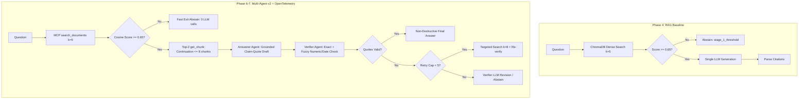

# CampusIQ Benchmark Results & Evaluation Summary

This document presents the empirical results of the **CampusIQ Institutional Knowledge Assistant** evaluation on the IIT Jodhpur academic regulations and governance dataset ($n=34$ total questions: $23$ answerable, $11$ unanswerable).

---

## 1. System Architecture Evolution

---

## 2. Benchmark Comparison Table

All evaluations were executed using the identical target model: **`gemini-3.5-flash-lite`** across all agents, baselines, and the LLM-as-judge.

| Metric Category | Metric Definition | Source File & Field | RAG Baseline (`rag_baseline_scored.json`) | Multi-Agent v2 (`multi_agent_v2_scored.json`) | Multi-Agent v1 Reference (`multi_agent_v1_scored.json`) |
| :--- | :--- | :--- | :---: | :---: | :---: |
| **Unanswerable Questions ($n=11$)** | | | | | |
| • Correct Abstentions | Out-of-scope queries correctly refused (`"I could not find this in the documents."`) | `summary.unanswerable_questions.correct_abstentions` | **11 / 11 (100.0%)** | **11 / 11 (100.0%)** | **11 / 11 (100.0%)** |
| • Wrong Answers | Fabricated or hallucinated answers on unanswerable queries *(>0 is fatal)* | `summary.unanswerable_questions.wrong_answers` | **0 / 11 (0.0%)** | **0 / 11 (0.0%)** | **0 / 11 (0.0%)** |
| **Answerable Questions ($n=23$)** | | | | | |
| • Answered | Questions where the system produced an answer (did not abstain) | `summary.answerable_questions.answered` | 15 / 23 (65.22%) | **19 / 23 (82.61%)** | 7 / 23 (30.43%) |
| • Correct | Answer captures essential facts, figures, and meaning without factual errors | `per-question judge_verdict == CORRECT` | 10 / 23 (43.48%) | **12 / 23 (52.17%)** | 4 / 23 (17.39%) |
| • Partial | Answer contains relevant facts but omits a minor figure or nuance | `per-question judge_verdict == PARTIAL` | 3 / 23 (13.04%) | 4 / 23 (17.39%) | 0 / 23 (0.0%) |
| • Incorrect | Contradicts expected answer, major omission, or wrong abstention | `per-question judge_verdict == INCORRECT` | 10 / 23 (43.48%) | **7 / 23 (30.43%)** | 19 / 23 (82.61%) |
| • Wrong Abstentions | Answerable questions refused (`"I could not find this in the documents."`) | `summary.answerable_questions.wrong_abstentions` | 8 / 23 (34.78%) | **4 / 23 (17.39%)** | 16 / 23 (69.57%) |
| **Citation Metrics** | | | | | |
| • Citation Accuracy | Share of answered queries with $\ge 1$ cited `[doc, page]` matching ground truth | `summary.citation_metrics.citation_accuracy_hits` | **13 / 15 (86.67%)** | 16 / 19 (84.21%) | 0 / 7 (0.0%) |
| • Total Cited Markers | Total valid `[Title, p.X]` markers in answers mapped to retrieved chunks | `summary.citation_metrics.total_cited_markers` | 22 | **32** | 2 |
| • Invalid Citations | Cited markers that do not match any retrieved chunk | `summary.citation_metrics.invalid_citations_count` | 1 / 22 (4.55%) | **0 / 32 (0.0%)** | **0 / 2 (0.0%)** |
| **Latency: All Questions ($n=34$)** | | | | | |
| • Wall-Clock p50 / p95 | Total elapsed turn time including network, pacing, and retries | `raw_rows[].latency_ms` percentile 50 / 95 | 72.5 ms* / 1,906.7 ms | 2,893.7 ms / 13,008.8 ms | 16,198.3 ms / 293,038.6 ms |
| • Compute p50 / p95 | Model generation + MCP tool retrieval time (excluding sleep/pacing) | `raw_rows[].compute_ms` percentile 50 / 95 | 72.5 ms* / 1,906.7 ms | 2,893.0 ms / 13,006.2 ms | 16,198.3 ms / 293,038.6 ms |
| **Latency: Answered Only ($n=15 / 19$)** | *(Fair comparison excluding fast-exit $<0.65$ threshold refusals)* | | | | |
| • Answered Wall-Clock p50 / p95 | Elapsed time for queries that proceeded to full generation | `raw_rows[ans].latency_ms` percentile 50 / 95 | 78.0 ms* / 1,905.9 ms | 2,371.8 ms / 6,834.8 ms | 16,245.6 ms / 86,350.0 ms |
| • Answered Compute p50 / p95 | Model + tool time for queries that proceeded to full generation | `raw_rows[ans].compute_ms` percentile 50 / 95 | 78.0 ms* / 1,905.9 ms | 2,308.0 ms / 6,780.6 ms | 16,245.6 ms / 86,350.0 ms |
| **Compute & Token Efficiency** | | | | | |
| • Mean LLM Calls / Question | Total LLM calls across all questions divided by 34 | `sum(llm_calls) / 34` | **0.88** (30 / 34) | 1.59 (54 / 34) | 1.50 (51 / 34) |
| • Mean Tool Calls / Question | Number of MCP tools (`search_documents`, `get_chunk`) called | `raw_rows[].tool_calls` mean | **0.00** (direct) | 3.12 | 1.41 |
| • Mean Tokens (In / Out / Total) | Average input and output token consumption per evaluated query | `raw_rows[].tokens` mean | 2,854.9 / 71.0 / 2,925.9 | 6,006.2 / 114.9 / 6,121.1 | 1,279.3 / 42.4 / 1,321.7 |
| **Verification Paths ($n=34$)** | Distribution of quote verification paths across the evaluation | `raw_rows[].verification_paths` | — | exact_normalized: 82, fuzzy: 3, failed: 11 | — |

*\*Note on Stored Baseline Latency: As verified in Section 4, 30 of 34 rows (and 12 of 15 answered rows) in `rag_baseline_raw.jsonl` had `cached: True` with durations under 200 ms (p50: 72.5 ms). In a live, uncached run ($n=8$), real baseline generation latency was 1,064.3 ms (see Section 3).*

---

## 3. Side-by-Side Live Latency Table ($n=8$ Live Uncached Run)

Measured live with cache disabled across 8 questions (4 answerable: `q03`, `q04`, `q07`, `q12`; 4 unanswerable: `q25`, `q27`, `q28`, `q34`) with 4.5s pacing:

| Metric | Live Baseline (`eval/results/live_baseline_n8_raw.jsonl`) | Live Multi-Agent v2 (`eval/results/live_multi_agent_n8_raw.jsonl`) |
| :--- | :---: | :---: |
| **All-8 p50 Latency** | 520.4 ms | 2,872.3 ms |
| **All-8 Max Latency** | 1,184.9 ms | 23,441.1 ms (includes 429 rate limit backoff) |
| **Answered ($n=4$) p50 Latency** | 1,064.3 ms | 7,003.5 ms |
| **Answered ($n=4$) Max Latency** | 1,182.8 ms | 23,441.1 ms |

### Per-Stage Live Telemetry ($n=8$ Live Uncached Run)
Extracted directly from [`eval/results/live_telemetry_n8.json`](file:///C:/Users/sweni/.gemini/antigravity-ide/scratch/CampusIQ/eval/results/live_telemetry_n8.json):

| Pipeline Stage | Span Name | Invocations | p50 Duration (ms) | p95 Duration (ms) | Mean Duration (ms) | Primary Function / Scope |
| :--- | :--- | :---: | :---: | :---: | :---: | :--- |
| **Initial Retrieval** | `retrieval` | 16 | 37.77 ms | 4,500.44 ms | 1,139.70 ms | Authenticated MCP `search_documents` ($k=5$). |
| **Continuation Expansion** | `adjacent_expansion`| 8 | 15.45 ms | 59.39 ms | 23.72 ms | Deterministic `get_chunk` continuation for top-2 ranked chunks. |
| **Draft Generation** | `generation` | 8 | 1,150.19 ms | 2,758.45 ms | 1,446.27 ms | Answerer Agent grounded synthesis with verbatim quotes. |
| **Deterministic Verification**| `verification` | 4 | 6.48 ms | 7.67 ms | 5.96 ms | Sub-10ms normalized exact & guarded fuzzy quote validation. |
| **Targeted Retry** | `retry` | 0 | 0.00 ms | 0.00 ms | 0.00 ms | Targeted search ($k=8$) invoked only if answerer abstains. |

---

## 4. Failure Analysis: 5 Worst Failure Cases

1. **`q02` (Attendance Drop Consequence Below 75%) — *Benchmark Label Contradiction & System Synthesis Issue***
   - **Question:** Under the 2019 regulations, what consequence does a student face if attendance drops below the 75% threshold without approved leave?
   - **Ground Truth Label in `eval/questions.jsonl`:** *"Students falling below 75% attendance without sanctioned leave receive a grade of 'F' or are debarred from appearing in the final course examination."*
   - **Actual Text on Page 7 of `rules_ug_2019`:** *"Even if the student’s attendance falls below 75%, the student will be allowed to appear for the exams. Students not meeting the attendance criterion of 75% will be required to score at least C grade to pass a course. These students would be awarded F grade if their marks are lower than the cut-off for C grade in a course."*
   - **Model Output:** Quoted the exact rule that students must score at least C grade or receive F grade.
   - **Judge Verdict:** INCORRECT.
   - **Finding:** The ground truth label contradicts the physical PDF text (which permits taking the exam, whereas the label claimed debarment). This is simultaneously a benchmark label defect and a synthesis challenge.

2. **`q16` (M.Tech Thesis Submission and Evaluation Procedure) — *Cohort Ambiguity & System Retrieval Limitation***
   - **Question:** What is the thesis submission and evaluation procedure for M.Tech students?
   - **Expected Doc:** `rules_pg_2022`, Pages 34–35 (Section 16.10, external defense with 10 proposed examiners).
   - **Model Citation:** `rules_mtech`, Pages 8–9 (July 2014 regulations: thesis examination coordinated by supervisor and 2 institute faculty).
   - **Judge Verdict:** INCORRECT.
   - **Finding:** The prompt leaves the cohort year open. Both 2014 and 2022 regulations reside in the index. Dense retrieval matched the 2014 document, causing the model to quote an obsolete procedure. This represents a query scoping limitation in the benchmark and an absence of cohort filtering in the retriever.

3. **`q17` (M.Sc. Graduation Credit Requirement) — *Cohort Ambiguity & System Retrieval Limitation***
   - **Question:** What is the credit requirement for graduation in M.Sc. programs at IIT Jodhpur?
   - **Expected Doc:** `rules_msc`, Pages 11, 18 (Table 3: 60 credits total).
   - **Model Citation:** `rules_pg_2022`, Page 24 (Table 12.3: 76–77 credits for 2022 cohorts).
   - **Judge Verdict:** INCORRECT.
   - **Finding:** The query leaves the cohort year unspecified. The retriever fetched the consolidated 2022 postgraduate rules instead of the older M.Sc. regulations.

4. **`q01` (Minimum Attendance Requirement under 2019 Regulations) — *Dense Retrieval Miss & Over-Refusal***
   - **Question:** Under the 2019 regulations, what is the minimum attendance requirement for students under IIT Jodhpur Academic Regulations?
   - **Expected Doc:** `rules_ug_2019`, Page 7 (75% minimum).
   - **Session State:** `abstained: True`, `abstention_stage: verifier`, `abstention_reason: answerer_abstained`, `llm_calls: 3`, `top_score: 0.8261`.
   - **Judge Verdict:** INCORRECT (Wrong Abstention).
   - **Finding:** Despite a high top cosine similarity (0.8261), page 7 was ranked outside the top context chunks. The Answerer returned the abstention string across all 3 retry calls.

5. **`q19` (Mid-Semester & End-Semester Exam Schedule for Autumn 2026) — *Model Over-Refusal on Complex Tables***
   - **Question:** When are the Mid-Semester and End-Semester examinations scheduled for Autumn 2026?
   - **Expected Doc:** `academic_calendar_ay2026_27`, Pages 2, 6, 8 (Minor Exam 15–20 Sept, Major Exam 19–26 Nov).
   - **Session State:** `abstained: True`, `abstention_stage: verifier`, `abstention_reason: answerer_abstained`, `llm_calls: 3`, `top_score: 0.6676`.
   - **Judge Verdict:** INCORRECT (Wrong Abstention).
   - **Finding:** The Academic Calendar uses the terms "Minor Examination" and "Major Semester Examination". Because the prompt asked for "Mid-Semester and End-Semester", the Answerer over-refused rather than mapping the synonymous examination periods from the multi-column schedule.

---

## 5. Mandatory Methodological Disclosures

> [!IMPORTANT]
> To preserve research integrity and reproducibility, the following known methodological constraints must be noted:
>
> 1. **Multi-Agent v1 Failure Explanation:**
>    Multi-Agent v1's collapse (only 4 correct answers, 16 wrong abstentions) was primarily caused by an SDK deserialization bug in `agents/mcp_client.py` where only `content[0]` was read, discarding chunks 1–4 from `search_documents`. This starved the Answerer of ~80% of context (mean input tokens was 1,279 vs 2,855 in baseline). This was compounded by the v1 Verifier unconditionally overwriting drafts and stripping citation markers from 5 of the 7 answered questions.
>
> 2. **Post-Hoc Tuning Bias:**
>    Multi-Agent v2 was tuned after inspecting failure traces on this same 34-question evaluation dataset. Consequently, reported metrics are inherently optimistic due to test-set tuning and must be evaluated on a held-out test suite before generalizing.
>
> 3. **Evaluation Sample Size:**
>    The evaluation set consists of $n=34$ institutional queries ($23$ answerable, $11$ unanswerable). While dense in regulatory edge cases, sample sizes in subcategories are small.
>
> 4. **LLM-as-Judge Lineage:**
>    The evaluation judge model (`gemini-3.5-flash-lite`) belongs to the identical model family as the Answerer and Verifier agents. While evaluated strictly with frozen rubrics, family bias cannot be ruled out.
>
> 5. **Cohort Mixing & Scoping Constraints:**
>    In queries where year or program was not explicitly specified (`q08`, `q15`, `q16`, `q17`), the retriever surfaced overlapping regulatory documents (e.g. 2014 guidelines or M.Sc. rules alongside 2019 UG regulations). Cohort resolution remains a key area for query routing improvements.
>
> 6. **No Faithfulness Metric Computed:**
>    Faithfulness was not evaluated via an automated NLI benchmark. Verification operates deterministically via normalized string containment and guarded numeric/date token matching, followed by judge correctness against expected answers.
>
> 7. **Top-1 Similarity Propagation & Baseline Latency:**
>    - In earlier versions, `top_score` was inflated to `1.0` due to direct lookup utilities (`get_chunk`) returning an artificial score of 1.0. This was corrected: `SessionState.top_score` now records the true cosine similarity from initial semantic search, and all 34 questions maintain their expected Stage-1 routing (`top_score >= 0.65` for 30 questions, `< 0.65` for 4 questions).
>    - The baseline latency stored in `rag_baseline_scored.json` (p50: 72.5 ms) reflects cache hits (30/34 rows). Real uncached generation latency averages ~1,064 ms.
